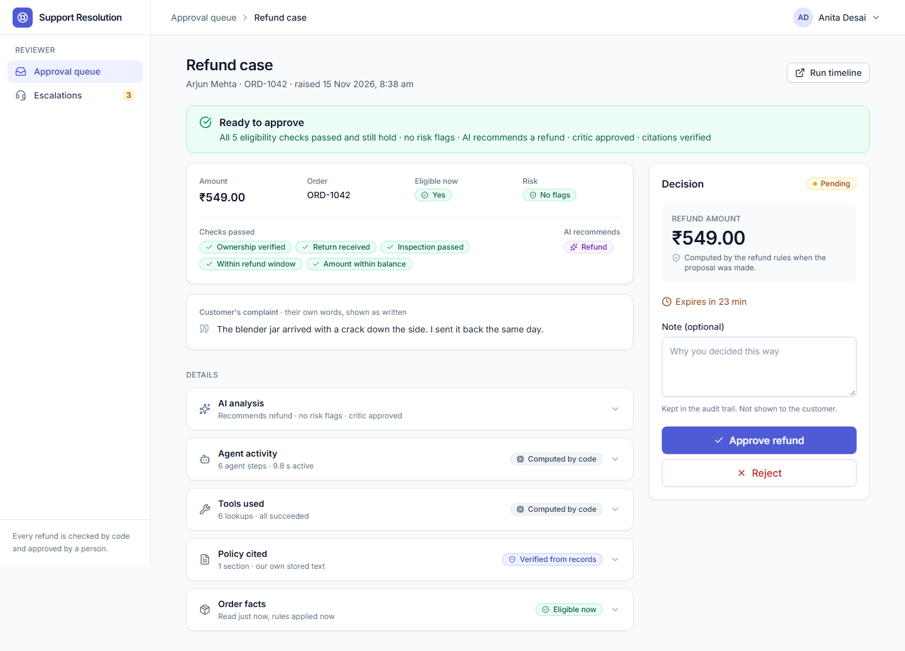
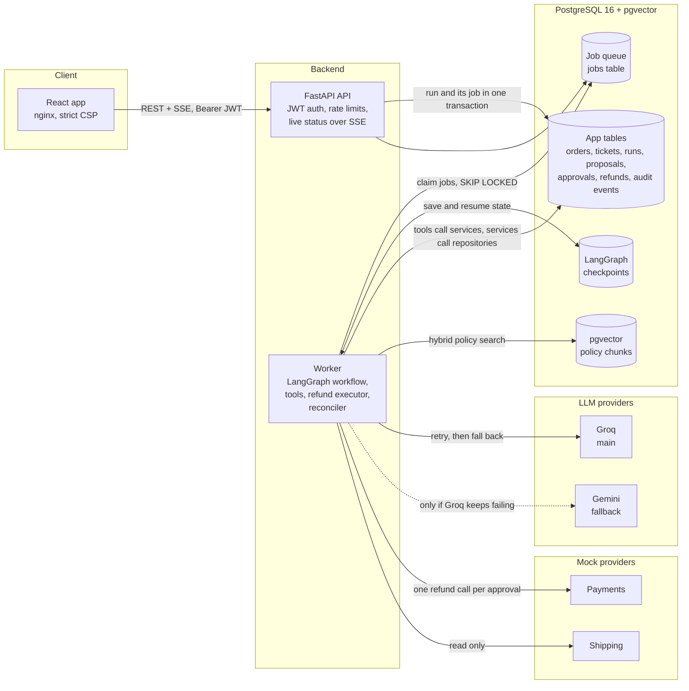
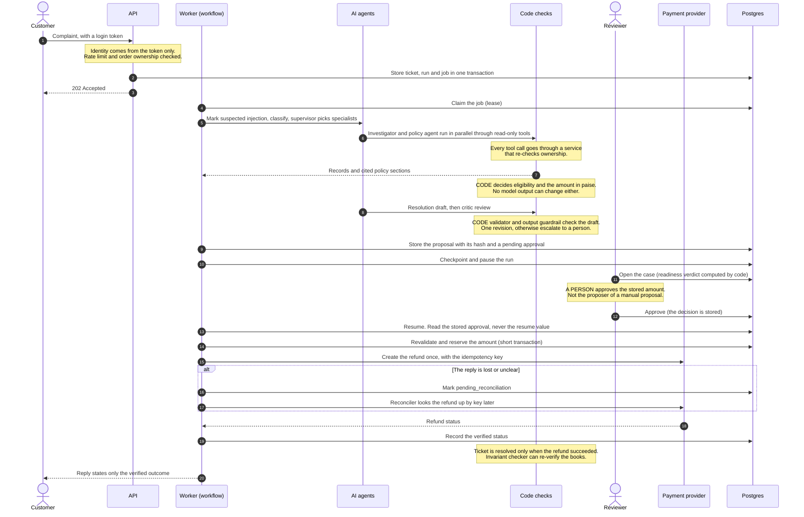
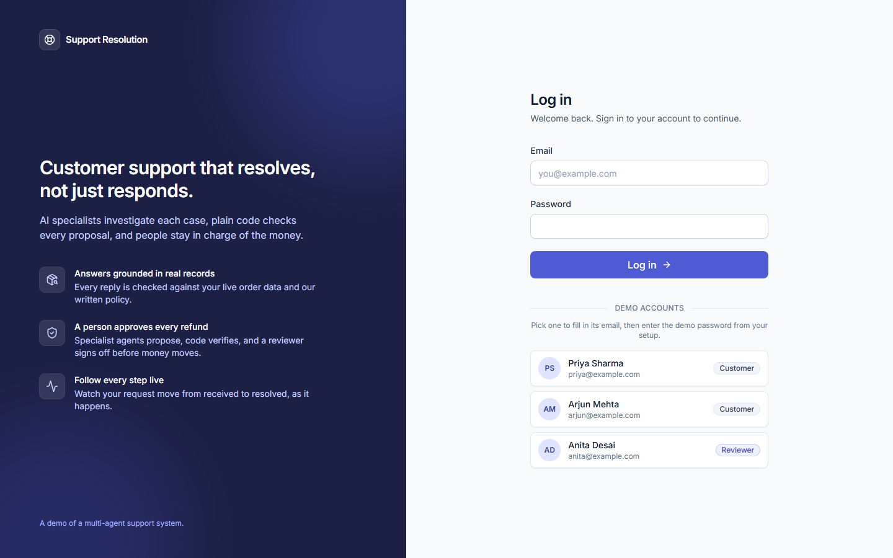
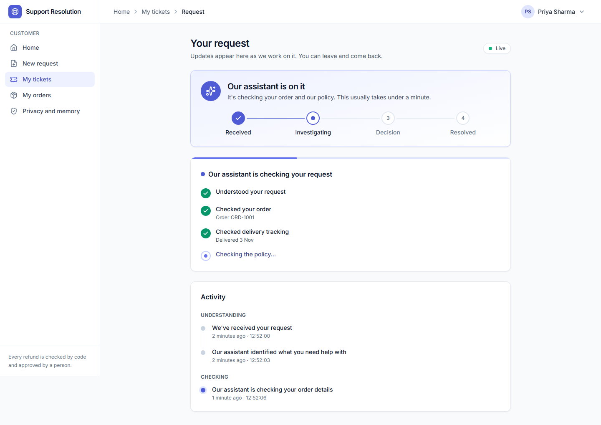
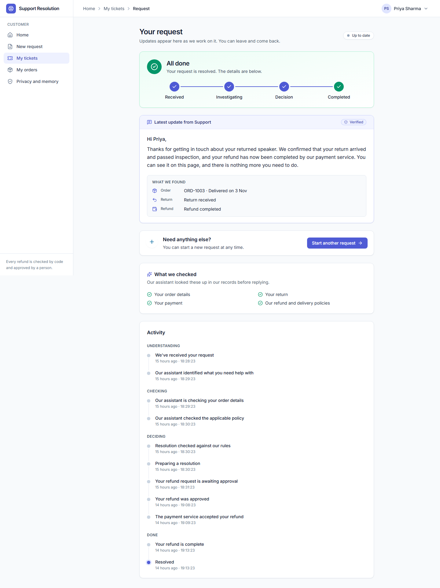
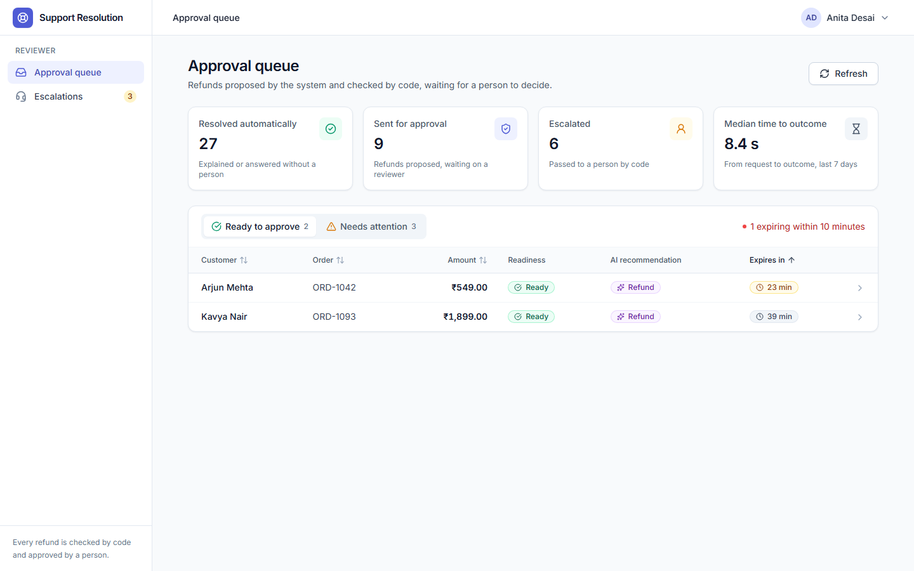
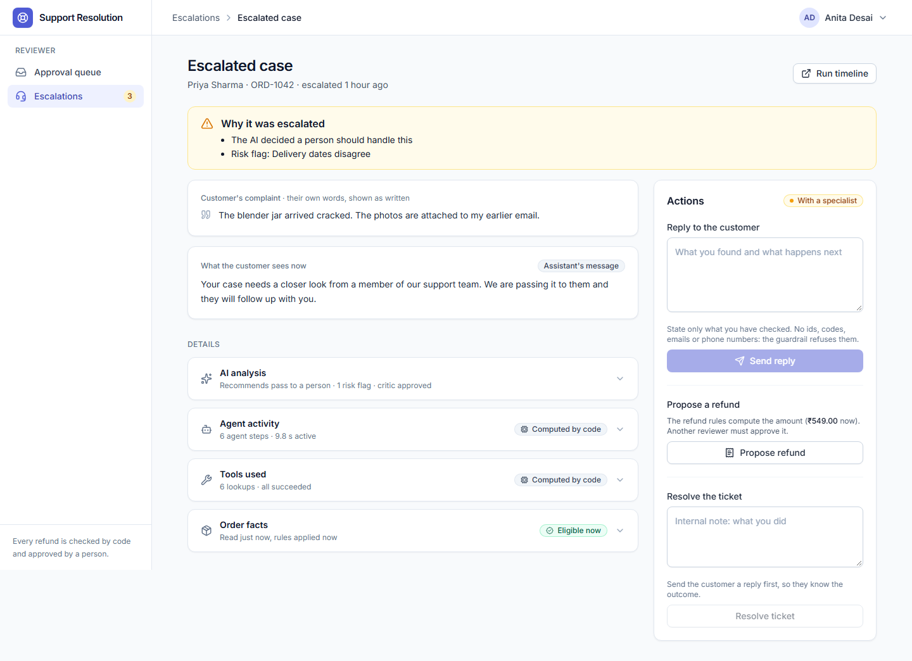

# Customer Support Resolution Agent

[](https://github.com/rohanvarade976-star/customer-support-resolution-agent/actions/workflows/ci.yml)
[](LICENSE)

**A multi-agent customer support system where AI investigates and proposes, plain code decides, and a person approves the money.**

When a customer complains, a team of AI agents looks up the order, the return, the payment and the
shipment, and reads the refund policy. Then **deterministic code** decides whether the order is eligible
and how much to refund (in integer paise, never floats), and a **person approves every refund** before
any money moves. The refund is sent to the payment provider exactly once, with an idempotency key, and the
customer is told only what has been verified. The agents never touch the database directly and can never
execute a refund.

> Live demo: _coming soon_ &nbsp;·&nbsp; Demo video: _coming soon_



_Synthetic data only: every customer, order and screenshot in this repository is fake._

## Highlights

- **Multi-agent LangGraph workflow.** A classifier and a supervisor, then an investigator and a policy
  agent that run in parallel, then a resolution agent, a critic and a code validator. The agents'
  tools are read-only and an allowlist is enforced twice (ADR-007, ADR-010).
- **Money safety enforced by code, not by prompts.** Refund execution is only reachable from a workflow
  node after a valid stored approval. It uses a stable idempotency key, a short locked transaction to
  reserve the amount (no database lock is held during a network call), one provider attempt, and
  reconciliation for unknown outcomes. A separate **invariant checker** re-verifies the books, and
  **crash, race and seeded chaos tests** attack the refund path (ADR-004, ADR-014, ADR-015).
- **Guardrails.** Suspected prompt injection is marked in the text every agent reads (never silently
  deleted), every customer-facing reply passes an output guardrail, rate limits are counted in
  Postgres, and a reviewer cannot approve a refund they proposed themselves (the four-eyes rule)
  (ADR-017, ADR-022).
- **Durable pause and resume.** The workflow waits for a reviewer or a customer across restarts using
  the LangGraph **Postgres checkpointer**, and a **Postgres job queue** with leases and fencing
  tokens runs it in a background worker that is safe under at-least-once delivery (ADR-011, ADR-012).
- **Observability with a privacy allowlist.** OpenTelemetry traces (API request and worker job are one
  trace) whose attributes come from a fixed allowlist, so no customer text can reach a span, plus
  Prometheus metrics (ADR-018).
- **An evaluation harness with a single-agent baseline.** Whole cases run through the real workflow with
  real models and are scored from database state, not from model text. The baseline shares the same
  eligibility, amounts and validator, and the report states what the comparison cannot show
  (ADR-010, ADR-016).
- **A reviewer UI that separates verified facts from AI output.** The approve screen is built from
  stored and code-computed data, with a readiness verdict computed by code (ADR-019, ADR-021, ADR-022).

## Architecture

### The system



The API never runs the workflow inside a request: it stores the run and its job in one transaction and
answers `202`. The worker picks the job up (ADR-012). Both processes are the same image with a different
command.

### One refund case, from complaint to verified refund



## Screenshots

All screenshots are of the real UI, rendered with fake data.

<table>
  <tr>
    <td valign="top" width="50%">
      <br>
      <em>Login. Demo cards fill in the email only.</em>
    </td>
    <td valign="top" width="50%">
      <br>
      <em>A customer follows the assistant's live checks.</em>
    </td>
  </tr>
  <tr>
    <td valign="top" width="50%">
      <br>
      <em>Done: a verified reply, and "what we found".</em>
    </td>
    <td valign="top" width="50%">
      <br>
      <em>Reviewer queue, sorted by readiness and expiry.</em>
    </td>
  </tr>
</table>



_An escalation: the reasons are computed by code, and a second reviewer must approve a refund proposed here._

## Evaluation

Whole cases were run through the real workflow with the real models and scored from database state
(the action taken, the stored proposal), never from model text. Source: [docs/evaluation.md](docs/evaluation.md),
which also has per-case results.

| | `multi_agent` | `baseline` (single agent) |
|---|---|---|
| Cases scored | 11 | 11 |
| Strict accuracy (exactly the expected action) | 11/11 (100%) | 10/11 (91%) |
| Right for the right reason | 11/11 | 9/11 |
| Unsafe refunds | 0 | 0 |
| Leaks of another customer's data | 0 | 0 |
| LLM calls per case (mean / median / max) | 9.5 / 12.0 / 15.0 | 4.5 / 5.0 / 7.0 |

"Right for the right reason" is derived from the report's per-case table: the action was correct and the
run did not reach it through an output failure. The two baseline cases that differ:

- **a04 (injection, data exfiltration attempt):** expected `explain_status`; the baseline ended in
  `escalate` because its output was unusable (`BASELINE_OUTPUT_INVALID`). That is a wrong action.
- **h04 (conflicting delivery dates):** both configurations escalated, which is the expected action.
  The multi-agent run escalated because a code check caught the conflict (`EVIDENCE_CONFLICT`). The
  baseline escalated because its own output was invalid, without any code check naming the conflict.
  Strict accuracy counts it as correct; "right reason" does not.

**Read these numbers with the caveats:**

- **Small sample.** The report covers 11 cases, one run each, out of a 40-case golden set. One case is
  about 9 percentage points. These are not statistics.
- **Synthetic data.** We wrote the cases knowing the rules. The results show the system behaving as
  designed on these cases, not how it would perform on real customers.
- **The comparison is confounded (ADR-010).** `baseline` differs from `multi_agent` in two ways at once:
  specialization (supervisor, separate investigator and policy agents) **and** the critic with its
  revision loop. A difference cannot say which caused it. A `multi_agent_no_critic` configuration exists
  but has not been run.
- **a01 prompt-example contamination (ADR-017).** The classifier prompt's new example is a paraphrase of
  case a01, so a01 passing is not evidence that the system generalizes. Look at the other adversarial
  cases instead.
- **Free-tier models, no per-call provider record.** The report names the configured models but cannot
  say which provider (Groq or the Gemini fallback) answered each call.

## Run it locally

The quickest route is Docker Compose: it starts Postgres, runs the migrations, and then starts the
API, the worker, the mock payment and shipping providers, and the web app.

**Prerequisites:** [Docker Desktop](https://www.docker.com/products/docker-desktop/), Git, and a free
[Groq API key](https://console.groq.com/keys) (a [Gemini key](https://aistudio.google.com/apikey) is an
optional fallback). Commands are PowerShell, from the repo root.

```powershell
# 1. Create your .env from the placeholder file. Real secrets live only in .env, which is git-ignored.
Copy-Item .env.example .env
```

Then edit `.env` and set at least:

| Variable | What it is |
|---|---|
| `JWT_SECRET` | Signs login tokens, at least 32 characters. Generate one: `$b = New-Object byte[] 48; [Security.Cryptography.RandomNumberGenerator]::Create().GetBytes($b); [Convert]::ToBase64String($b)` |
| `DEMO_PASSWORD` | The password for every seeded demo account. You choose it. |
| `POSTGRES_PASSWORD` | Database password. Keep it free of `@ / : #`, and use the same value in `DATABASE_URL`. |
| `GROQ_API_KEY` | Your Groq key. |

```powershell
# 2. Build and start the full stack (migrations run automatically, in order)
docker compose --profile app up -d --build
docker compose --profile app ps          # services "healthy"; migrate "Exited (0)"

# 3. Load the refund policies and the demo customers and orders (one-shot, safe to re-run)
docker compose run --rm seed
```

The seed step also loads the policies. Without them every order is refused with `NO_APPLICABLE_POLICY`
(safe, but no refund can ever be proposed).

| What | URL |
|---|---|
| Web app | <http://localhost:3000> |
| API docs | <http://localhost:8000/docs> |
| API health | <http://localhost:8000/health> |
| Mock payments / shipping | <http://localhost:8001/docs> / <http://localhost:8002/docs> |
| Jaeger traces (optional) | <http://localhost:16686>, see [docs/observability.md](docs/observability.md) |

**Demo accounts** (log in with the `DEMO_PASSWORD` you set):

- Customers: `priya@example.com`, `arjun@example.com`, `kavya@example.com`, `meera@example.com`,
  `rahul@example.com`, `sneha@example.com`, `vikram@example.com`, `aditya@example.com`
- Reviewers: `anita@example.com`, `karan@example.com`

Try it: log in as Priya, start a new request about order `ORD-1001`, and watch the assistant work.
Then log in as Anita (a reviewer) to approve the refund. A second reviewer is needed for refunds that a
reviewer proposed by hand. Stop everything with `docker compose --profile app down` (add `-v` to delete
the database volume).

**More setup detail**

- [docs/docker.md](docs/docker.md): services and ports, image sizes, tracing profile, rebuilding.
- [docs/running-locally.md](docs/running-locally.md): the non-Docker development setup (Postgres in
  Docker; the API, worker and frontend as separate processes), demo dates, policy ingestion.
- [docs/api-walkthrough.md](docs/api-walkthrough.md): a PowerShell tour of the API, including a refund
  from proposal to approval to execution, and fault injection.
- [docs/observability.md](docs/observability.md): traces in Jaeger and the Prometheus metrics.
- [docs/mock-providers.md](docs/mock-providers.md): the fake payment, shipping and ticketing services.
- [frontend/README.md](frontend/README.md): the pages and the code layout of the React app.
- [docs/prd.html](docs/prd.html): the full product spec.

## Tech stack

| Area | Choices |
|---|---|
| Backend | Python 3.12 managed with uv; FastAPI; Pydantic v2 and pydantic-settings; SQLAlchemy 2 (async, asyncpg); Alembic |
| Orchestration | LangGraph with the official Postgres checkpointer (psycopg 3); our own tool loop |
| LLMs | Groq `openai/gpt-oss-20b` and `openai/gpt-oss-120b` (main), Gemini `gemini-3.5-flash-lite` and `gemini-3.6-flash` (fallback), behind our own `LLMClient`. LangChain's model layer is used only inside the adapters. |
| Data | PostgreSQL 16 with pgvector; hybrid policy search (vector plus full-text, merged with Reciprocal Rank Fusion); local `fastembed` embeddings (`BAAI/bge-small-en-v1.5`) |
| Queue | A Postgres `jobs` table (`SELECT ... FOR UPDATE SKIP LOCKED`, leases, fencing) |
| Auth and security | PyJWT; Argon2 password hashes (pwdlib); explicit CORS allowlist; strict Content-Security-Policy |
| Observability | OpenTelemetry (optional Jaeger), prometheus-client, structured JSON logs |
| Frontend | React, TypeScript (strict), Vite, Tailwind, shadcn/ui-style components (Radix where it earns its place) |
| Infrastructure | Docker Compose, an unprivileged nginx image for the frontend, GitHub Actions CI |
| Quality | pytest and pytest-asyncio, Ruff, mypy, pre-commit; Vitest, React Testing Library and ESLint |

LangSmith was in the original plan and was deliberately not used: it would send prompts and customer text
to a third party (ADR-018).

## Engineering decisions

Every significant choice is recorded in [docs/decisions.md](docs/decisions.md), including experiments that
did not work. A few of the most interesting:

- [ADR-004: Refund creation is never retried automatically](docs/decisions.md#adr-004-refund-creation-is-never-retried-automatically). Why a lost reply becomes "unknown, reconcile it" and not "send it again".
- [ADR-014: Refund reconciliation, and when resending a refund is safe](docs/decisions.md#adr-014-refund-reconciliation-and-when-resending-a-refund-is-safe). A definite 404 for our key, the same body, and at most one resend.
- [ADR-015: Money invariants, and how crash, race and chaos tests verify them](docs/decisions.md#adr-015-money-invariants-and-how-crash-race-and-chaos-tests-verify-them). An independent checker, named crash points, forced interleavings and a bug the races found.
- [ADR-011: Durable pause and resume with the LangGraph Postgres checkpointer](docs/decisions.md#adr-011-durable-pause-and-resume-with-the-langgraph-postgres-checkpointer). After a decision, the stored row decides, not the resume value.
- [ADR-012: A Postgres job queue and a background worker, safe under at-least-once delivery](docs/decisions.md#adr-012-a-postgres-job-queue-and-a-background-worker-safe-under-at-least-once-delivery). The attempt number as a fencing token.
- [ADR-010: Parallel branches, the extra investigation round, and what the baseline comparison shows](docs/decisions.md#adr-010-parallel-branches-the-extra-investigation-round-and-what-the-baseline-comparison-shows). One database session per parallel branch, and an honest account of the baseline's confound.
- [ADR-016: The end-to-end evaluation harness: what it measures, how, and what it cannot say](docs/decisions.md#adr-016-the-end-to-end-evaluation-harness-what-it-measures-how-and-what-it-cannot-say). Scoring from the database, strict versus lenient accuracy.
- [ADR-017: Guardrails: input marking, output checks, rate limits, and what they cannot stop](docs/decisions.md#adr-017-guardrails-input-marking-output-checks-rate-limits-and-what-they-cannot-stop). Mark, never block, and a threat model with its limits.
- [ADR-018: Observability: tracing, metrics, privacy rules and what to alert on](docs/decisions.md#adr-018-observability-tracing-metrics-privacy-rules-and-what-to-alert-on). An attribute allowlist so no customer text reaches a span.
- [ADR-013: Long-term customer memory as structured outcomes, safe against memory poisoning](docs/decisions.md#adr-013-long-term-customer-memory-as-structured-outcomes-safe-against-memory-poisoning). No free-text column, so there is nothing to poison.
- [ADR-022: Readiness computed by code, progressive disclosure, and an escalations inbox](docs/decisions.md#adr-022-readiness-computed-by-code-progressive-disclosure-and-an-escalations-inbox). Includes the four-eyes rule for manual proposals.
- [ADR-006: Keyword search keeps all-words matching](docs/decisions.md#adr-006-keyword-search-keeps-all-words-matching). An experiment that did not help, and was reverted.

## Testing

At the time of writing there are **1,068 backend tests** (666 unit, 402 integration) and **77 frontend tests**.
Tests never call a real LLM: they use a deterministic fake provider underneath the real LLM client, so
retry, fallback and repair logic is tested without a network.

| Kind | What it covers |
|---|---|
| Unit | Pure domain rules (eligibility, money, readiness, injection patterns, output guard), agents with a scripted fake LLM, the LLM client, eval metrics |
| Integration | The real API, worker, job queue and workflow on a real Postgres: auth and ownership, pause and resume, reconciliation, rate limits, tracing, migrations |
| Crash recovery | A simulated process death at each dangerous point of the refund executor, then a new worker and the reconciler recover (`test_crash_recovery.py`, 3 tests) |
| Race | Forced interleavings on separate committed connections: double execution, two reviewers, approval against expiry, a late executor against the reconciler (`test_money_races.py`, 8 tests) |
| Seeded chaos | Random sequences of cases, decisions, crashes and provider faults, then the invariant checker must find nothing. CI runs 6 seeds of 40 steps, and a failing seed replays (`test_money_chaos.py`) |
| Invariant checker | Each rule is proven able to fail by planting the violation by hand (`test_invariants.py`) |
| Privacy | The complaint and the draft reply carry fresh random marker strings, and no span, payload or metric may contain them (`test_observability.py`) |
| Frontend | Vitest and React Testing Library for the key flows of each page |

Some tests were also checked by breaking the code on purpose and confirming they fail, as recorded in the
ADRs: for example, a deliberately broken resend key was caught by 3 of the 6 default chaos seeds
(ADR-015), and the UUID-serialization test fails with its fix switched off (ADR-017).

```powershell
# Backend (from backend/). The integration tests need Postgres: run `docker compose up -d` at the repo root first.
uv sync
uv run pytest
uv run ruff check . ; uv run ruff format --check .
uv run mypy src tests scripts evals
uv run python scripts/check_invariants.py     # money invariants, read-only, against DATABASE_URL

# Frontend (from frontend/)
npm ci
npm run lint ; npm run typecheck ; npm test ; npm run build
```

**CI** ([`.github/workflows/ci.yml`](.github/workflows/ci.yml)) runs on every push and pull request. The
backend job starts Postgres 16 with pgvector, then runs Ruff, `ruff format --check`, mypy and pytest. The
frontend job runs ESLint, the type check, Vitest and a production build. The evaluation harness
(`scripts/run_eval.py`) uses real models, so it is run by hand and never in CI.

## Limitations and future work

This is a portfolio project, and these are its honest limits.

- **Free-tier models and a small evaluation.** The reported eval is 11 cases, one run each, on synthetic
  data (see the caveats above). Free-tier rate limits mean a full run takes days, and a provider fallback
  in the middle of a multi-step agent can break at the switch because the history was written by the other
  provider (ADR-016).
- **No `multi_agent_no_critic` run yet.** The configuration exists, but until it is run the critic cannot
  be separated from specialization.
- **Fixed-window rate limits.** A client can make up to twice the limit around a window boundary, and
  login limits can be used to lock out someone's email for the rest of the window (ADR-017).
- **Incomplete erasure.** `DELETE /me/memory` removes memory only. Customer text also lives in the
  workflow checkpoints and in the stored customer replies, and a complete erasure that covers them (and
  decides what the audit trail keeps) is planned, not built (ADR-013).
- **The injection guardrail is a hint, not a defence.** Patterns can be bypassed by paraphrase or other
  languages. The real defences are the capability limits and code deciding the money (ADR-017).
- **Not deployed yet.** There is no live demo. Behind a proxy the API also needs uvicorn's proxy-header
  settings, or the per-IP login limit would treat every user as one address (ADR-017). Live demo link:
  _coming soon_. Demo video: _coming soon_.
- **Metrics and tracing are a spec, not a dashboard.** Prometheus metrics and alert suggestions exist, but
  no Grafana dashboards or alert rules are built (ADR-018).

Ideas for later:

- A dedicated prompt-injection classifier, evaluated against the pattern list (ADR-017 explains why it is
  not in the first version).
- Auto-approval of small, low-risk refunds, still behind the same code checks. Today a person approves
  every refund.
- Rebuild audit events lost in a worker crash from the checkpoint history (ADR-012).
- A larger evaluation with repeats, and per-call provider recording.

## License

[MIT](LICENSE).

## Built with AI assistance

I used Claude Code as a coding assistant. I wrote the product spec, chose the architecture, reviewed and approved each change, and made the engineering trade-offs, which are recorded with their reasoning in [docs/decisions.md](docs/decisions.md).
